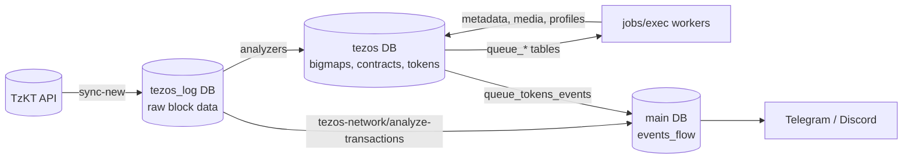

# CryptoNoises

Backend of CryptoNoises: Telegram and Discord bots that notify users about activity of their Tezos wallets and NFTs
(sales, offers, listings, mints, transfers), plus a Tezos indexer that feeds them.

The project was unmaintained for several years and ran on PHP 7.4. It has since been moved to PHP 8.4 with current
dependencies, and it ships as a docker-compose stack: see [Running with Docker](#running-with-docker).

## Components

| Part | Namespace | What it does |
|------|-----------|--------------|
| Tezos indexer | `src/CryptoNoisesTezos` | Syncs transactions and bigmap updates from the Tezos blockchain, analyzes markets, syncs token/contract metadata, downloads IPFS media and builds previews. |
| Bots + API | `src/CryptoNoises` | Telegram bot (webhooks), Discord bot (long-running threads), notification queues, hunters that turn transactions into events. |
| Core | `src/CryptoCore` | Shared infrastructure: DB wrapper, CLI commands base, job queues, environment config. |

Entry points:

| Path | Type | Purpose |
|------|------|---------|
| `public-api/` | web root | Telegram webhooks. |
| `public-app/` | web root | Short links that redirect to marketplaces (`/token/...`, `/user/...`, `/collection/...`). |
| `commands/run` | CLI | Bots + API commands: the notifier and event loops, Discord threads, maintenance. |
| `commands/run-tezos` | CLI | Indexer commands: the sync and analyze stages, the queue workers, maintenance. |
| `bin/discord-*` | shell | Start / stop / restart Discord bot threads. |

Run `commands/run` or `commands/run-tezos` without arguments to print the list of available commands.

## Requirements

The quickest way to get all of this is [Docker](#running-with-docker), which pins the versions below.

- PHP 8.3 or newer (built and tested on 8.4) with extensions: `curl`, `gd`, `mbstring`, `fileinfo`, `json`,
  `pdo_mysql`, plus `openssl` and `zlib` for the Discord and Telegram clients.
- MySQL 8.0+ / MariaDB 10.6+.
- Composer.
- ImageMagick and `ffmpeg` for media previews. ImageMagick 7 installs as `magick`; version 6 installs as `convert`.
  Point `tezos.cmd_imagemagick_convert` at the one you have.
- A web server (Apache with `mod_rewrite`, or nginx) for `public-*` folders.

## Dependencies

The stack was moved off PHP 7.4 (end of life since November 2022) onto PHP 8.4, and every dependency to its current
release:

| Dependency | Was | Now | What changed in this project |
|------------|-----|-----|------------------------------|
| PHP | 7.4 | 8.4 | `composer.json` requires `^8.3` and pins the platform to 8.4. |
| `bcosca/fatfree` (routing / DB) | 3.8.1 | 3.9.3 | Nothing. 3.9.x is what makes PHP 8.4 work: 3.8.1 died on `E_STRICT is deprecated`. |
| `team-reflex/discord-php` | 7.3.4 | 10.72 | `Discord\InteractionType` still exists, and the builder API (`MessageBuilder`, `ActionRow`, `Button`, `TextInput`) is unchanged. The Parts moved namespace: `Parts\Channel\Message` -> `Parts\Channel\Message\Message`, `Parts\Embed\Embed` -> `Parts\Channel\Message\Embed\Embed`, `Parts\Interactions\Command\*` -> `Parts\Application\Command\*`, `Parts\User\Member` -> `Parts\Guild\Member\Member`. v10 keeps silent `class_alias` shims for all of them; this code uses the new names. `ComponentRepository` is gone, replaced by `Discord\Helpers\ExCollectionInterface`. |
| `react/promise` (via discord-php) | 2.9 | 3.3 | `done()` was removed: the 12 promise call sites use `then()`. Unhandled rejections are no longer thrown but logged by react's default rejection handler, which suits a long-running bot. |
| `monolog/monolog` (via discord-php) | 2.8 | 3.13 | Integer log levels still work; the thread logger uses the `Monolog\Level` enum. |
| `davtur19/turibot` (Telegram API) | 1.20 | 2.16 | This one changed the most. Argument order moved (`editMessageText()` takes `$text` first now), `message_thread_id` was inserted into the middle of several signatures, `disable_web_page_preview` became the `link_preview_options` object and `thumb` became `thumbnail`. Every call now passes **named arguments**, so a future insertion cannot silently shift a parameter. |

Checks that pass on PHP 8.4: `php -l` over all 527 files, loading all 515 **project** classes under
`error_reporting(E_ALL)` with no diagnostics, and `vendor/bin/phpstan analyse` (level 0: no undefined classes,
methods or functions) with no errors.

None of that was enough on its own. Running the indexer against the live TzKT API turned up the
[undefined array keys](#undefined-array-keys-notices-on-74-fatal-on-8x), and sending a request through the
Telegram webhook turned up two more fatals in the first few lines of that path - neither of which any static
check can see, because the data that triggers them comes from outside.

One deprecation does remain, in the vendor code rather than this project's: turibot 2.16 declares
`getUpdate(string $body = null)`, which PHP 8.4 deprecates as an implicitly nullable parameter. It is raised
while the class is compiled, before Fat-Free's handler can turn it into a fatal, so it is logged to
`log/php_error.*.log` and nothing breaks - verified by driving a request through the webhook. 2.16 is the newest
release, so there is nothing to upgrade to; the project never calls that method, only loads the class.

**Error handling is the thing to remember here.** Fat-Free installs an error handler that turns *any* reported
diagnostic into `$f3->error(500, ...)`, and its `HALT` default ends the process with `die(1)`. Since
`error_reporting` keeps `E_WARNING` and `E_DEPRECATED`, a single warning anywhere kills the running command - and in
a sequential indexer stage, that wedges the stage on one block for good. This is why moving from 7.4 to 8.x was
mostly a hunt for reads that used to be harmless notices. When you next raise the PHP version, expect the same:
run the indexer against live data and watch `log/php_error.*.log`, because a new deprecation will stop a worker
or a scheduled command rather than just log a line.

## Running with Docker

The compose stack covers everything except a TLS terminating proxy: MySQL, the two web entry points, the indexer,
the bots and the three Discord threads.

```bash
cp .env.example .env            # fill in DB_* passwords; bot tokens can stay empty for an indexer-only run
docker compose up -d db         # MySQL
docker compose up db-init       # schema + reference data + start level (one-shot, safe to re-run)
docker compose up -d              # db, php, nginx, scheduler, and the indexer workers
```

That gives a running indexer and the web endpoints. Start the bots only once the indexer has caught up with the
chain (see [Enabling the bots](#enabling-the-bots)):

```bash
docker compose --profile bots up -d
```

### Services

| Service | What it is | Notes |
|---------|------------|-------|
| `db` | MySQL 8.4, all four databases | Started with `innodb_flush_log_at_trx_commit=2` and no binary log, which is the right trade for the write-heavy initial sync. Read [Initial sync from block 1](#initial-sync-from-block-1) before pointing this at a replicated server. |
| `db-init` | One-shot: creates the databases and grants, applies `sql/schema/`, loads `sql/data/`, applies `TEZOS_START_LEVEL`, creates the current month's log tables | Idempotent: the schema is `CREATE TABLE IF NOT EXISTS`, and the reference data is loaded only when `fixer_transactions_sync` is empty. |
| `php` | php-fpm for `public-api/` and `public-app/` | |
| `nginx` | Serves both web roots and the media previews | Ports `8080` (webhooks), `8081` (redirects), `8082` (previews). |
| `worker-*` | Queue workers: token metadata, media previews, contracts, profiles, token detection | Interchangeable, so **scale them freely**. See [Workers](#workers-instead-of-cron). |
| `stage-*` | The sequential stages: both syncs, both sync-checks, both analyzers, and the bots' wallet events | Each walks a block cursor and must stay a **single instance** - never scale these. |
| `scheduler` | supercronic running the ~15 entries that genuinely need a clock | [`docker/cron/schedule.cron`](docker/cron/schedule.cron): janitors, hourly log-table cleanup, daily housekeeping. |
| `bots-*` | The bots' poll loops: Telegram notifiers, mint / update events, wallet sync, exchange rates | Keep stopped until the indexer has caught up. |
| `discord-main-loop`, `discord-notifier`, `discord-assistant` | The three long-running Discord threads | Each runs in the foreground as its container's main process, so Docker restarts them instead of `bin/discord-start` and the process-list check. |

### Configuration

`.env` is the only file you edit. The image ships [`docker/config/consts-secrets.php`](docker/config/consts-secrets.php)
and [`docker/config/environment.php`](docker/config/environment.php) as `config/consts-secrets.php` and
`config/environment.php`; both read every setting from the environment at runtime. Missing database credentials fail
with a named variable instead of an empty-password connection attempt.

To use hand-written config files instead, bind-mount them over `/opt/cryptonoises/config/consts-secrets.php` and
`/opt/cryptonoises/config/environment.php`, which replaces the env-driven ones.

`TEZOS_START_LEVEL` picks where the indexer starts, and `db-init` applies it to all four places that have to agree
(see [`sql/data/README.md`](sql/data/README.md), which lists what a later start level costs you):

- `1` indexes the whole chain history. This is the faithful choice and takes days to reach the head.
- A recent level (look up [the head](https://api.tzkt.io/v1/head) and subtract a margin) catches up in minutes, but
  the indexer then only knows tokens minted from that block on, and ownership data stays incomplete for older
  tokens until their balances change. Good for a test stand.

It only applies to a fresh database; changing it later does nothing, because `db-init` will not re-seed.

### Running commands by hand

Every CLI command works through the `php` service. Run them as `www-data`, so the files they write stay writable by
the services:

```bash
docker compose exec -u www-data php commands/run-tezos            # list indexer commands
docker compose exec -u www-data php commands/run                  # list bots / API commands

docker compose exec -u www-data php commands/run-tezos /blockchain/transaction/sync-new verbose=1
docker compose exec -u www-data php commands/run /telegram/webhook/set
docker compose exec -u www-data php commands/run /discord/bot/commands/create
```

Logs:

```bash
docker compose logs -f scheduler               # supercronic reports every scheduled job, including failures
docker compose logs -f stage-sync-transactions # a sequential stage
docker compose logs -f worker-tokens-metadata  # all replicas of one worker, interleaved
docker compose logs -f discord-notifier

# Workers print nothing unless something goes wrong. To watch one work, run it by hand with verbose=1:
docker compose exec -u www-data php commands/run-tezos /jobs/exec jobId=sync-tokens-metadata verbose=1 timeLimit=30
```

### ImageMagick

Token media is untrusted and the previews are public, so the image ships a restrictive
`docker/imagemagick/policy.xml`: every coder is denied except the raster formats `MediaTool` actually converts, all
delegates (ghostscript and friends) are off, and the URL / SVG / MSL / MVG modules are blocked. This is the
`policy.xml` the [Security notes](#security-notes) ask for.

Debian 13 ships ImageMagick 7, whose binary is `magick`, so the container sets
`TEZOS_CMD_IMAGEMAGICK_CONVERT=/usr/bin/magick`.

### Published images

The whole stack runs one image of its own (`db` and `nginx` are stock), and
[`.github/workflows/docker-image.yml`](.github/workflows/docker-image.yml) publishes it to GitHub Container
Registry on every push to `main`:

| Tag | |
|-----|---|
| `sha-<short>` | immutable, one per commit - **use this for a deployment** |
| `main` | moves with the default branch |
| `latest` | the same as `main` |
| `v1.2.3`, `1.2` | from a `v*` git tag, if the project ever gets releases |

Pull requests build the image and run the smoke test but publish nothing, so a broken `Dockerfile` never reaches
the registry. The smoke test checks more than "it builds": both CLI entry points list their commands, every PHP
extension the project needs is loaded, ImageMagick refuses an SVG (so `policy.xml` is really in effect), and a
missing database credential fails non-zero rather than looking like a clean exit.

## Deploying

`compose.yaml` builds locally, which is what you want for development. A deployment adds a **site overlay** on
top: [`docker-compose.site.example.yml`](docker-compose.site.example.yml), copied to `docker-compose.site.yml` and
kept applied through `COMPOSE_FILE`. `compose.yaml` itself is never edited, so the repo and the host's local
choices do not fight.

```bash
cp .env.example .env
cp docker-compose.site.example.yml docker-compose.site.yml
```

In `.env`:

```ini
COMPOSE_FILE=compose.yaml:docker-compose.site.yml
CN_IMAGE=ghcr.io/teia-community/cryptonoises:sha-abc1234
```

Then the usual two commands, which now pull instead of building:

```bash
docker compose pull
docker compose up -d
```

What the overlay changes:

- **No published ports.** Traefik terminates TLS and reaches the container over its external `web` network. This
  is not only tidier - on a Traefik host the ports this stack defaults to are taken, because `8081` and `8082`
  are Traefik's own dashboard and metrics entrypoints.
- **Three hostnames**, each of which must resolve to the host before a certificate can be issued: the webhook
  endpoint, the redirect endpoint, and the media previews. They have to match `APP_PUBLIC_API_URL`,
  `APP_PUBLIC_DOMAIN` and `TEZOS_IPFS_LOCAL_BASE_URL` respectively, because those values are registered with
  Telegram and embedded in bot messages.
- **Lower worker counts**, sized for a machine that runs other things, with `worker-ipfs-secondary` at 0 since
  nothing pushes to that queue.

Pinning the `sha-` tag rather than `main` makes a redeploy a deliberate change of one line and a rollback the
previous value. The host still needs these files - `compose.yaml`, `.env`, the nginx config and the two public
document roots live there - but it never builds anything: the application comes from the registry.

A newly created GHCR package is **private**, so the host needs `docker login ghcr.io` with a token that has
`read:packages`, or the package has to be made public in the organisation's package settings.

## Dumps, backups and seeding a new deployment

Two kinds of dump, and the difference is the point:

| | Contains | Personal data |
|---|---|---|
| `seed` | the three indexer schemas: chain data | **none** |
| `full` | the above plus the bots schema: users, their wallets, their Telegram chat ids and Discord user ids, and the monthly message-log tables | **yes** |

The bots schema is the only one with personal data in it. The `telegram` and `discord_name` columns in
`profiles_tzkt` / `profiles_tzprofiles` are self-published on-chain handles, already public by their owner's
choice, so a `seed` dump can be moved around without ceremony. `db-dump` **refuses to upload a `full` dump to
S3 without `BACKUP_PASSPHRASE`.**

```bash
docker compose --profile backup  run --rm db-backup seed    # chain data only
docker compose --profile backup  run --rm db-backup full    # everything
docker compose --profile restore run --rm db-restore latest
```

Both are behind profiles because only one instance should write to a given S3 prefix - a standby or a staging
box must not prune the one that matters. For a nightly dump, add it to `docker/cron/schedule.cron` on the
instance that owns the prefix.

Artifacts are `gzip`ed, encrypted with AES-256 (PBKDF2) when `BACKUP_PASSPHRASE` is set, kept in the `backups`
volume and optionally uploaded with [`s5cmd`](https://github.com/peak/s5cmd) to any S3-protocol endpoint
(`BACKUP_S3_URL`, `BACKUP_S3_ENDPOINT`). Old artifacts of the same kind are pruned by the timestamp in their
name, so re-uploading an old one cannot make it look fresh.

The dump uses `--single-transaction` (a consistent snapshot that does not lock out the running workers),
`--routines` (`sql/schema/tezos.sql` defines `ADDR2ADID()` and `ADID2ADDR()`), `--hex-blob` (`ipfs_uri` and the
token tags are `varbinary` holding arbitrary bytes from the chain) and `--no-tablespaces` (the application user
has no global `PROCESS` privilege).

### Seeding a deployment from a local sync

Indexing the whole chain takes days, so it is reasonable to do it once somewhere convenient and move the result.
The cursors travel with the dump, so the new instance only catches up the gap.

`db-restore` refuses to run over databases that already hold indexer data unless `BACKUP_RESTORE_FORCE=1`, and
prints the two steps that still need doing before the bots start (see
[Enabling the bots](#enabling-the-bots)) - after a full-history sync `queue_tokens_events` holds one mint event
per token that ever existed.

**The media previews are not in the dump.** `ipfs_media` rows say a token has a thumbnail; the file lives in the
`ipfs-previews` volume at a path derived from a hash of its IPFS URI. Copy that volume too, or older tokens
simply have no image in their notifications.

## Installation without Docker

```bash
composer install
cp config/consts-secrets.example.php config/consts-secrets.php
cp config/environment.example.php    config/environment.php
```

Both copied files are gitignored. Fill them in as described below.

### `config/consts-secrets.php` - credentials

| Constants | Description |
|-----------|-------------|
| `kSECRET_MYSQL_*` | PDO DSN + credentials for the bots/API databases: `main`, `log`, `shared`. |
| `kSECRET_TEZOS_MYSQL_*` | PDO DSN + credentials for the indexer databases: `tezos`, `tezos_log`. |
| `TELEGRAM_BOT_API` | Token of the main Telegram bot (from @BotFather). |
| `TELEGRAM_ASSISTANT_API`, `TELEGRAM_ASSISTANT_USER_ID` | Optional assistant bot; answers only to the given Telegram user id. |
| `TELEGRAM_DEBUGGER_API`, `TELEGRAM_DEBUGGER_USER_ID` | Debugger bot: Fatal / Error / Warning logs are sent to this user. |
| `TELEGRAM_WEBHOOK_SECRET` | Random secret for webhook authorization (see [Telegram webhooks](#telegram-webhooks)). |
| `kDISCORD_TOKEN_MAINBOT` | Discord bot token for main-loop and notifier threads. |
| `kDISCORD_TOKEN_ASSISTANT` | Discord bot token for the assistant thread (may be the same bot). |
| `kDISCORD_GUILD_ID` | Your Discord server id: the assistant thread syncs its members (needs the privileged `GUILD_MEMBERS` intent). |
| `kDISCORD_CLIENT_ID_MAINBOT` | Application id of the main bot, used for "invite bot to server" links. |

### `config/environment.php` - deployment settings

| Key | Description |
|-----|-------------|
| `environment` | `production`, `development` or `development-local`. Token mint / update notifications work only in `production`, see [Enabling the bots](#enabling-the-bots). |
| `api.public_domain` | Base URL of `public-app/`. |
| `api.public_api_url` | Base URL of `public-api/` (Telegram webhooks are registered on it). |
| `api.discord.channel_auto_join_hi` | When set, the main-loop thread requests the privileged `MESSAGE_CONTENT` intent (enable it in the Discord developer portal, or the bot cannot connect). |
| `api.links.*` | Public links used in bot messages and redirects: homepage, Twitter, Discord invite / ticket channel, Discord privacy help, privacy policy. Empty value hides the related button or text line. |
| `api.limits.*` | Limits, the same for every user: `wallets` (50), `following` (1000), `offers_max_holders` (250: an offer on a token or collection with more holders is not sent to anyone). |
| `api.discord.*` | Optional Discord channel ids: auto-join channels and "missed message" channel. |
| `api.channel_user_ids.*` | Optional broadcast feeds (see comments in the example file). |
| `tezos.ipfs_gateway_url` | IPFS gateway that token metadata and media are read through (default `https://ipfs.io/ipfs/`). See [IPFS gateway](#ipfs-gateway). |
| `tezos.ipfs_fetch_gateway_url` | Gateway that metadata and media are fetched through first, e.g. the `ipfs` sidecar; `ipfs_gateway_url` is the fallback. Never stored or sent. See [Running your own IPFS node](#running-your-own-ipfs-node). |
| `tezos.ipfs_local_base_url` / `tezos.ipfs_local_base_path` | Where media previews are stored and from which URL they are served. |
| `tezos.private_storage_base_path` | Storage for downloaded originals. |
| `tezos.cmd_imagemagick_convert`, `tezos.cmd_ffmpeg` | Paths to external tools. |
| `tezos.cmd_timeout` | Path to coreutils `timeout`; kills conversions that run longer than `tezos.media.tool_timeout_sec`. Empty string disables it. |
| `tezos.media.*` | Media previews: JPEG thumbnail width / quality (256 px, 60%); optional mp4 video preview and GIF animated preview (both off by default) with their width, bitrate, fps; input duration limit (30 s); ImageMagick / ffmpeg run time limit (60 s). |

### Database

The project uses 4 MySQL / MariaDB databases on one server (cross-database queries are used, so one DB user needs
access to all of them). Database names are free - they are taken from the DSNs in `config/consts-secrets.php`.
The schema was verified on MySQL 8.0 and MariaDB 10.6.

| Schema file | Connection in code | Constant(s) in `consts-secrets.php` |
|-------------|--------------------|-------------------------------------|
| `sql/schema/main.sql` | `dbMain`, `dbLog` | `kSECRET_MYSQL_HOST_MAIN`, `kSECRET_MYSQL_HOST_LOG` (**same database**) |
| `sql/schema/shared.sql` | `dbShared` | `kSECRET_MYSQL_HOST_SHARED` |
| `sql/schema/tezos.sql` | `dbTezos` | `kSECRET_TEZOS_MYSQL_HOST_MAIN` |
| `sql/schema/tezos_log.sql` | `dbTezosLog` | `kSECRET_TEZOS_MYSQL_HOST_LOG` |

```bash
for db in cryptonoises cryptonoises_shared cryptonoises_tezos cryptonoises_tezos_log; do
    mysql -e "CREATE DATABASE $db CHARACTER SET utf8mb4 COLLATE utf8mb4_unicode_ci"
done

mysql cryptonoises           < sql/schema/main.sql
mysql cryptonoises_shared    < sql/schema/shared.sql
mysql cryptonoises_tezos     < sql/schema/tezos.sql
mysql cryptonoises_tezos_log < sql/schema/tezos_log.sql

# after config/consts-secrets.php and config/environment.php are filled in:
commands/run /lifecycle/prepare/tables     # creates the log tables for the current month
```

Notes:

- Schema files can be applied again safely (`CREATE TABLE IF NOT EXISTS`).
- Some tables are created by the code at runtime, they are not in the schema:
  - monthly log tables `<name>_YYYY_MM` (bots DB) - from `template__<name>` tables by `/lifecycle/prepare/tables`
    (the `scheduler` service runs it daily, and `db-init` creates the current month; without Docker, run it once
    by hand after creating the schema);
  - block-range tables `transactions_NNNNxxxx` / `bigmap_updates_NNNNxxxx` (Tezos log DB) - from
    `template__transactions_0xxxx` / `template__bigmap_updates_0xxxxx` of the Tezos DB, during blockchain sync;
  - `temp__events_flow_locked_ids__*` (bots DB).
- `sql/schema/tezos.sql` also creates two helper functions for manual queries: `ADDR2ADID(address)` and
  `ADID2ADDR(adid)`.
- Optional: `sql/schema-helpers/main_stats_views.sql` and `sql/schema-helpers/tezos_stats_views.sql` add `stats_*`
  views with queue / state counters for manual monitoring. The code does not use them.
- Then load the reference data and the indexer start points (`sql/data/`, see its [README](sql/data/README.md)):

  ```bash
  sql/data/load.sh main   cryptonoises
  sql/data/load.sh shared cryptonoises_shared
  sql/data/load.sh tezos  cryptonoises_tezos
  ```

  Without the start rows the sync commands stop with `<fixer table>: no jobs yet, seed the start level first`, see
  [How the Tezos indexer works](#how-the-tezos-indexer-works).

### Web server

Point two (sub)domains to `public-api/` and `public-app/`. Each folder has an `.htaccess`
that routes all requests to its `index.php`. For nginx use the equivalent `try_files $uri /index.php?$query_string;`.

Serve `tezos.ipfs_local_base_path` as static files from `tezos.ipfs_local_base_url`.

## Telegram webhooks

Telegram delivers updates to `public-api/`:

| Bot | Webhook path |
|-----|--------------|
| Main bot (`TELEGRAM_BOT_API`) | `/telegram/webhook` |
| Assistant (`TELEGRAM_ASSISTANT_API`) | `/telegram/assist` |
| Debugger (`TELEGRAM_DEBUGGER_API`) | `/telegram/debug` |

How authorization works:

1. Generate a random `TELEGRAM_WEBHOOK_SECRET` (1-256 chars of `A-Z a-z 0-9 _ -`), e.g. `openssl rand -hex 32`.
2. Register webhooks for all configured bots:
   ```bash
   commands/run /telegram/webhook/set
   ```
   This calls Telegram `setWebhook` with `url = api.public_api_url + path` and `secret_token = TELEGRAM_WEBHOOK_SECRET`.
3. Telegram sends the secret in the `X-Telegram-Bot-Api-Secret-Token` header with every update.
   `TelegramWebhookAuth` compares it with `hash_equals()`. Requests without a valid header get `403` and are not logged.

Bots without a token are skipped. After changing the secret or the domain, run `/telegram/webhook/set` again.
Check the current state with `commands/run /telegram/webhook/info`.

### Without a public HTTPS endpoint: polling

A test stand or a laptop cannot receive webhooks. For those, the main bot can fetch its updates itself:

```bash
docker compose --profile telegram-poll up -d bots-telegram-poll
```

`/telegram/poll` long-polls `getUpdates` and hands every update to the same code the webhook runs, so the bot
behaves the same either way. Telegram serves a bot one way or the other, never both: while a webhook is set it
refuses `getUpdates`, and the poller then logs that and idles rather than deleting the webhook - the token may be
the one a live deployment uses. Give a test stand its own bot.

The offset is stored before each update is handled, so an update that crashes the process is skipped on restart
instead of being fetched again and again - at most once. (A webhook request that fails is retried by Telegram for a
while; for a poller, a retry that crashes the same way is a restart loop.)

## Discord bot

The Discord bot runs as three long-running PHP processes:

| Thread | Purpose |
|--------|---------|
| `main-loop` | Handles slash commands, buttons and guild events. |
| `notifier` | Delivers queued notifications. |
| `assistant` | Syncs the members of your server (`kDISCORD_GUILD_ID`) into `discord_users`, and keeps a stats message up to date in the channel set by `discord.stats.main.channel-id` (DB `config` table, optional). |

With Docker each thread is its own service, supervised by Docker:

```bash
docker compose up -d   discord-main-loop discord-notifier discord-assistant
docker compose restart discord-notifier
docker compose logs -f discord-main-loop
```

Without Docker, the `bin/` scripts start them with `nohup`:

```bash
bin/discord-start   [all|main-loop|notifier|assistant]
bin/discord-stop    [all|main-loop|notifier|assistant]
bin/discord-restart [all|main-loop|notifier|assistant]
```

Register slash commands once (and after changing them):

```bash
docker compose exec -u www-data php commands/run /discord/bot/commands/create   # or: commands/run ...
```

A thread is detected by its command line `<project>/commands/run /discord/bot/start/<thread>`, so several copies
of the project can run on one host. Start threads via `bin/` (or by the real, non-symlinked path) so they are detected.
Under Docker that check is per container, which is why each thread gets its own service and Docker's `restart` policy
does the supervising instead of the `*/1 * * * * bin/discord-start` cron line.
Logs are written to `log/<Thread>-YYYYMMDD.log`.

## Operator alerts

Errors and fatals - `Log::Error`/`Fatal`, command `ERROR:` lines and PHP error files (deprecations ignored) - go to a
Matrix room (`MATRIX_ALERTS_ROOM`, invite the bot) and/or the Telegram debugger bot. Each error, digits ignored, goes
out at most once an hour with a count of repeats, and at most 30 alerts an hour. Existing installs need the
`ops_alerts_sent` table from `sql/schema/main.sql`.

**Stalls.** `/lifecycle/check/stalls` (every 5 minutes) alerts when a sync, analyzer or event stage that is not caught
up has not moved for 15 minutes, when a notification has waited 15 minutes, or when TzKT is not at the head.

## Digest

Users can bundle routine wallet activity (payments, NFT transfers, sales, offers, auctions, delegators) into one
message every 15 minutes, hour or 3 hours (Settings → "📬 Digest"). Such a notification waits until the end of the
window (`notify_after`, windows aligned on the clock); alerts, reminders and messages still go out at once. Existing
installs need `notify_after` on the `events_notifications_*` tables (live, template and monthly, after
`task_lifetime`) and `options_notifier.digest_minutes`; see `sql/schema/main.sql`.

## Teia events

`bots-teia-events` (profile `bots`) polls the Teia events contract (`KT1KDXX…913o`) every 5 minutes and announces each
new, visible event once to every user, with its banner and links. Users turn it off with the "📣 Teia events"
setting. The first run only records the existing events. Existing installs need:

```sql
ALTER TABLE options_notifier ADD COLUMN notify_teia_events enum('yes','no') DEFAULT NULL AFTER notify_domains;
```

### Teia multisig, DAO and polls

The same job watches the core team multisig (`KT1J9FYz…dHuvb`), the DAO governance contract (`KT1GHX73…YF66`) and the
community polls:

- **Multisig:** new proposals, and a reminder a day before one expires when a signer has not voted. These go to users
  watching a signer's wallet.
- **DAO:** new proposals, to everyone.
- **Community polls** (`KT1SUExZ…WoU`): new polls, to everyone.

Users can turn these off with "🏛 Teia multisig, DAO & polls". Existing installs need:

```sql
ALTER TABLE options_notifier ADD COLUMN notify_teia_governance enum('yes','no') DEFAULT NULL AFTER notify_teia_events;
```

## Matrix bot

A third messenger, notifications first: the same event and info notifications as on Telegram, in a direct message,
managed with text commands - `!add tz1… [name]`, `!wallets`, `!summary`, `!remove`, `!stop` (pause; any message
resumes), `!help`, and `!settings` for the user-level settings (`!on`/`!off <type>`, `!digest`, `!threshold`,
`!reminder`, `!attestations`). A bare Tezos address is taken as `!add`. Per-wallet filters stay on Telegram and Discord.

```sh
# .env: MATRIX_USER=@bot:example.org  MATRIX_PASSWORD=...  MATRIX_HOMESERVER_URL=https://matrix.example.org
docker compose --profile matrix up -d
```

- **Encryption.** Matrix direct messages are end-to-end encrypted by default, and PHP has no maintained Matrix
  encryption library, so the bot talks to the homeserver through [pantalaimon](https://github.com/matrix-org/pantalaimon),
  which encrypts and decrypts for it. That is also why the bot logs in with a password: pantalaimon needs its own
  device to hold the keys. The keys are in the `pantalaimon-data` volume; lose it and the bot comes back as a new
  device that cannot read what was encrypted to the old one. Pantalaimon has had no release since 2022 (v0.10.5).
- **Users.** Invite the bot to a direct message: it joins, answers with the help text, and that room is where your
  notifications go. It leaves rooms with more members. When you leave the room, it leaves too and stops notifying
  you. A Matrix user's `users` row holds the id of its `matrix_users` row in `platform_user_id`/`platform_channel_id`,
  which are numbers, while Matrix ids are strings.
- **Rendering.** Notifications are rendered from the Telegram variant of each template (its HTML is valid Matrix
  HTML), link buttons become links under the text, and a preview image is uploaded and sent as an `m.image` with the
  text as its caption.
- **Rate limits.** Synapse allows a normal account a message every 5 seconds after a burst of 10. The bot waits out
  `M_LIMIT_EXCEEDED`, but a busy bot should be exempted by the homeserver admin:
  `POST /_synapse/admin/v1/users/<bot user id>/override_ratelimit` with `{"messages_per_second": 0, "burst_count": 0}`.

Existing installs need:

```sql
-- cryptonoises: events_notifications_matrix, inform_notifications_matrix, matrix_users and
-- template__events_notifications_matrix from sql/schema/main.sql, and
ALTER TABLE users MODIFY `platform` enum('discord','telegram','matrix') DEFAULT NULL;
ALTER TABLE log_events MODIFY `platform` enum('discord','telegram','matrix') DEFAULT NULL;
```

## Workers instead of cron

Every long-running command in this project is a **polling loop that ends by itself**: `/jobs/exec` runs
`claimNextTask()` → work → repeat, the syncs and analyzers walk a block cursor the same way, and each one stops
after `worker.time_limit_sec` seconds. The original deployment set that to 55 and had cron restart everything every
minute, which meant ~92,000 PHP bootstraps a day whose only job was re-entering a loop that had just been killed.

The Docker stack runs them as processes instead, so nothing restarts them on a timer:

| | What | Scaling |
|---|------|---------|
| `worker-*` | The queue workers | **Scale at will:** `WORKERS_*` in `.env`. More workers mostly move the load to the database |
| `stage-*` | The sequential stages: both syncs, both sync-checks, both analyzers, the bots' wallet events | **Single instance each.** Two copies would fight over one cursor. |
| `bots-*` | The bots' poll loops (Telegram notifiers, mint / update events, wallet sync, exchange rates) | One each. |
| `scheduler` | supercronic, ~15 entries that genuinely want a clock | One. |

`WORKER_TIME_LIMIT_SEC` (default 3600) is how long a worker lives before it exits and the restart policy brings it
back. It is a **process lifetime, not a task deadline** - a worker always finishes the task in hand first. Recycling
hourly is cheap insurance against a slow leak in a long-lived PHP process; set it higher if you trust it, or back to
`55` to get the old cron-like behaviour.

Workers print nothing per level, but the two syncs and the three analyzers print one progress line a minute, so
`docker compose logs -f stage-sync-transactions` shows how a catch-up is going without querying the fixer tables:

```
21:58:04 sync operations/transactions: level 1,376,918 · +9,214 in 60s (154/s) · head 15,958,567, 14,581,649 behind, ETA 1d2h
```

Once caught up they drop to a line every ten minutes, as a heartbeat. `PROGRESS_LOG_INTERVAL_SEC` changes the
interval; `0` turns the lines off.

### Why the workers can be scaled now

`getNextTask()` used to be a plain `SELECT`, with a *separate* `UPDATE` marking the task `syncing`. That is a
read-then-write race, and the only thing that made it safe was the `queue_task_id % threadCount = threadIndex`
sharding: exactly one worker was ever allowed to look at a given row. That is why the old crontab hardcoded ten
copies of `sync-tokens-metadata`, each with its own `threadIdx` - the shard count *was* the concurrency limit, fixed
at deploy time.

`claimNextTask()` now selects and claims inside one transaction with `SELECT ... FOR UPDATE SKIP LOCKED`, so InnoDB
hands every concurrent worker a different row. Workers are interchangeable, the replica count is just a number, and
`threadIdx` / `threadCnt` are vestigial (still accepted, so an old crontab keeps working). This needs MySQL 8.0+ or
MariaDB 10.6+.

Verified on the test stand with 10 processes competing for 5000 tasks:

| Claim | Claims made | Unique | Tasks processed more than once |
|-------|-------------|--------|-------------------------------|
| `claimNextTask()` (`FOR UPDATE SKIP LOCKED`) | 5000 | 5000 | **0** |
| the old unlocked select + separate update | 46192 | 5000 | **5000** (every task, ~9x each) |

To be fair to the original: it was *correct in production*, because the sharding meant two workers never looked at
the same row. The second row is what you get if you take that code and scale it the obvious way - more workers
without more shards - which is exactly what we wanted to be able to do.

While we were in there, `kSELECT_MODE_Normal` lost its `ORDER BY priority, iteration, RAND()`. The `RAND()` was
there to stop parallel workers picking the same row, which `SKIP LOCKED` now does properly, and sorting a whole
backlog at random is expensive. The order is `priority, iteration, queue_task_id`.

#### The `claim` index

`SKIP LOCKED` makes concurrent claims *correct*, not cheap. The claim reads
`WHERE state = 'idle' AND ts_activate <= NOW() ORDER BY priority, iteration, queue_task_id LIMIT 1`, and the queue
tables only had single-column keys on `state`, `ts_activate` and `iteration`. None of them can deliver that order,
so MySQL read every idle row and sorted the lot to return one - under `FOR UPDATE`, which means it also *locked*
every row it read. Measured on a queue holding 62k rows:

| Plan | Rows read | Time |
|------|-----------|------|
| single-column `state` key, `Using filesort` | 61,965 | 185 ms |
| composite `claim` key | 1 | 0.6 ms |

Ten replicas each locking ~62,000 rows and then updating one by primary key deadlock constantly. A deadlock
(SQLSTATE 40001) reached the Fat-Free error handler, which ends the process; `restart: always` started the worker
straight back into the same contention, and the pool turned into a restart loop that pinned the host's CPU.

Two changes. Every claimable queue table gained `KEY claim (state, priority, iteration, queue_task_id)` - which has
`state` leftmost, so it replaces the plain `state` key rather than joining it - and `claimNextTask()` retries a lost
deadlock a bounded number of times before reporting the queue as empty, because 1213 is a normal outcome of
concurrency and must never be fatal.

Existing installs need the index added by hand (the schema files only run on a fresh database):

```sql
ALTER TABLE `cryptonoises_tezos`.`queue_contracts`             DROP INDEX `state`, ADD KEY `claim` (`state`,`priority`,`iteration`,`queue_task_id`);
ALTER TABLE `cryptonoises_tezos`.`queue_ipfs_primary`          DROP INDEX `state`, ADD KEY `claim` (`state`,`priority`,`iteration`,`queue_task_id`);
ALTER TABLE `cryptonoises_tezos`.`queue_ipfs_secondary`        DROP INDEX `state`, ADD KEY `claim` (`state`,`priority`,`iteration`,`queue_task_id`);
ALTER TABLE `cryptonoises_tezos`.`queue_profiles`              DROP INDEX `state`, ADD KEY `claim` (`state`,`priority`,`iteration`,`queue_task_id`);
ALTER TABLE `cryptonoises_tezos`.`queue_tokens_detected`       DROP INDEX `state`, ADD KEY `claim` (`state`,`priority`,`iteration`,`queue_task_id`);
ALTER TABLE `cryptonoises_tezos`.`queue_tokens_events`         DROP INDEX `state`, ADD KEY `claim` (`state`,`priority`,`iteration`,`queue_task_id`);
ALTER TABLE `cryptonoises_tezos`.`queue_tokens_metadata`       DROP INDEX `state`, ADD KEY `claim` (`state`,`priority`,`iteration`,`queue_task_id`);
ALTER TABLE `cryptonoises_tezos`.`queue_tokens_metadata_merge` DROP INDEX `state`, ADD KEY `claim` (`state`,`priority`,`iteration`,`queue_task_id`);
ALTER TABLE `cryptonoises`.`queue_domains_expiry`              DROP INDEX `state`, ADD KEY `claim` (`state`,`priority`,`iteration`,`queue_task_id`);
```

`queue_wallets_sync` is deliberately not in that list: it has no `state` or `iteration` column and is not claimed
through `claimNextTask()`.

### Pausing a command

`command-lock.<command>` in the `config` table still works, but it used to be read once per cron invocation - so
within a minute. A worker lives much longer than that, so `/jobs/exec` re-reads its switch every 10 seconds while
running and exits when it is set. The other services read it at startup, so for those use
`docker compose stop <service>`, which is the more honest way to pause a process anyway.

### Without Docker

[`crontab.example`](crontab.example) is still the original, complete, every-minute schedule, and it still works -
leave `worker.time_limit_sec` at `55` and nothing changes. To get the worker model outside Docker, run the same
commands under systemd units or supervisord with a large `worker.time_limit_sec`, and keep a crontab holding only
what [`docker/cron/schedule.cron`](docker/cron/schedule.cron) holds.

Most commands accept `verbose=1` to print progress when run by hand.

## How the Tezos indexer works

The indexer does not talk to a Tezos node: all chain data comes from the public [TzKT API](https://api.tzkt.io)
(`src/CryptoNoisesTezos/Vendors/Tzkt.php`), metadata and media from IPFS gateways, profiles from TzKT and
[Tezos Profiles](https://tzprofiles.com). It works block by block (`level` = block number) in three stages:



### 1. Sync: TzKT -> raw log tables

| Command (`run-tezos`) | Reads from TzKT | Writes |
|-----------------------|-----------------|--------|
| `/blockchain/transaction/sync-new` | `/v1/operations/transactions?level.ge=..&level.le=..` (a range of blocks per request) | `transactions_NNNNxxxx` (tezos_log DB), `blocks`, `address`, `transactions_entrypoints` |
| `/blockchain/bigmap-updates/sync-new` | `/v1/bigmaps/updates?level.ge=..&level.le=..` (a range of blocks per request) | `bigmap_updates_NNNNxxxx` (tezos_log DB) |
| `/blockchain/bigmap-updates/sync-check thread-id=N offset=M` | the same, again | re-counts the updates of a block `M` levels back; on mismatch it rolls sync and analysis back to that block |
| `/blockchain/*/cleanup offset=50000` | - | drops the log tables whose whole block range is more than `offset` blocks behind the slowest indexer reader (its sync and analyzer; the bots side is not taken into account) |

The raw tables are split by block ranges (`transactions_1417xxxx` = blocks 14170000..14179999; early ranges are
larger, up to 1M blocks) and created on the fly from `template__transactions_0xxxx` / `template__bigmap_updates_0xxxxx`.
A block is synced only when it is `kSYNC_BLOCK_BEHIND` (1) blocks behind the chain head
(`src/CryptoNoisesTezos/Config.php`).

`sync-new` loads a whole range of blocks per TzKT request (`src/CryptoNoisesTezos/Syncs/`): the range grows while
blocks are sparse and shrinks to what fits into one page of 10000 items; items are paged by id. Every block still gets
its own `fixer_*` row (empty blocks are written in bulk), so the analyzers, `sync-check` and the cursors work per block.

### Initial sync from block 1

`TEZOS_START_LEVEL=1` (the default) indexes the whole history, which is what gives the bots complete data. The
chain is at roughly 15.95M blocks at the end of 2026 and blocks get denser as it goes - NFTs appear from about
1.3M - so **plan for days**. [`sql/data/README.md`](sql/data/README.md) lists what a later start level
costs instead.

Measured on the test stand against a self-hosted TzKT, in the sparse region below level 600k. Quote the item
rates rather than the level rates when comparing: a level costs what its transactions cost, and levels get denser
as the chain goes on, so levels per second falls even when nothing has got slower.

| Stage | Levels/s | Items/s |
|-------|----------|---------|
| `stage-sync-transactions` | about 460 | about 1,340 |
| `stage-sync-bigmaps` | 36-44 | about 2,000 |

Both stages are single cursors that cannot be scaled sideways (see the `stage-*` row in [Services](#services)).
Running them together costs almost nothing: pausing the transaction sync moved the bigmap sync from 44 to 36
levels/s, which is noise.

Those numbers are what they are because of two changes, both worth knowing about if this code is profiled again:

- **Fat-Free's query log is disabled** in `VssDb::open()`. It built a regex per bound parameter and ran
  `preg_replace` with all of them over the statement, to store an interpolated copy nothing reads, and the log
  only grew. On the same 200-level range: 81.0s with it, 9.6s without.
- **A whole level range is written in one transaction**, with multi-row inserts, addresses resolved in bulk and
  one grouped `COUNT(*)` for the in/out check, instead of 9 + 2k queries per level. Same range: 9.6s to 2.2s.
  `SyncBigmapUpdates` still writes level by level and is the obvious next candidate.

**Keep the queue workers stopped while catching up.** They exist to fetch token metadata and build previews,
which is of no use until the syncs reach the levels that reference them, and 46 of them against one MySQL costs
the syncs throughput. Start them once the syncs are close to the head.

**What will not help:** MySQL tuning and faster storage. On a 659 MB database with an 8 GB buffer pool the test
stand ran at `Innodb_buffer_pool_reads = 0` and `Innodb_data_reads = 0` - not one physical read - with about
14 MB/s of writes and 18 fsyncs a second. There is no I/O to optimise, so ZFS recordsize, a faster disk or a
bigger buffer pool change nothing. TzKT is not the limit either: it answered a 100-level range in 86-250ms, which
is 1-3ms per level. What was left after the two changes above is PHP building rows, not the database.

What matters for the catch-up:

- **Your own TzKT.** This is the first thing to get right, not an optimisation. The sync asks TzKT for every block,
  and the public endpoint rate-limits long before the hardware is busy: see [TzKT API](#tzkt-api). A from-scratch
  sync against `api.tzkt.io` is not realistic.
- **MySQL write settings.** The compose `db` service already starts with `innodb_flush_log_at_trx_commit=2` and
  `--skip-log-bin`, which is the right trade for a write-heavy catch-up: InnoDB flushes its log once a second
  instead of on every commit, and nothing is written to a binary log. There is nothing to tune by hand under
  Docker. Outside Docker that is:

  ```ini
  [mysqld]
  innodb_flush_log_at_trx_commit = 2
  disable_log_bin                       # MySQL 8 writes a binary log by default; MariaDB does not
  ```

- **Do not use those settings on a replicated server.** A crash-safe replica needs
  `innodb_flush_log_at_trx_commit = 1` and `sync_binlog = 1`; with weaker values a crash leaves the primary and the
  replica silently out of sync. Run the catch-up on a server without replication, then restore the defaults, take a
  snapshot (`mysqldump`, Percona XtraBackup or the MySQL clone plugin) and build the primary and replica from it.
  Once caught up the indexer writes a block every few seconds, so the defaults are not a bottleneck.
- **Leave the `scheduler` running.** Its hourly `cleanup` entries drop the raw log tables that both the sync and
  the analyzer have passed; without them the Tezos log database grows for the whole catch-up.
- **Leave the bots stopped** until the indexer has caught up, see [Enabling the bots](#enabling-the-bots).

### TzKT API

All chain data comes from TzKT: `tezos.tzkt_api_url` (`TEZOS_TZKT_API_URL`), default
`https://api.tzkt.io/v1`. It used to be hardcoded in eight places in `Vendors/Tzkt.php`.

**The public endpoint will rate-limit you.** The indexer asks TzKT for every block, every bigmap it has not seen
before and every contract, so the request rate scales with the number of workers. On the test stand, 48 workers
earned a plain `HTTP 429` within minutes, which surfaces as `Cannot get bigmap data from tzkt` in the
`fixer_bigmap_updates_analyze` notice and stops that stage until `/jobs/recover-dead-jobs` resets the block. If you
index at any scale, run your own TzKT and point this at it - that is also what makes a full sync from block 1
realistic.

What the client does to follow TzKT's API terms and docs:

- **Attribution.** The free tier (up to 10 calls a second and 500,000 a day) requires it; the bots' help screen
  says "Data provided by TzKT API" with a link to tzkt.io.
- **TzKT Pro.** Set `TEZOS_TZKT_API_KEY` and the key goes out as the `apikey` header, as TzKT advises over the
  query string, and only to the configured TzKT URLs.
- **Retries.** Only what can succeed when asked again is retried: no answer, 408, 429 and 5xx. A 429 waits for
  what its `Retry-After` or `RateLimit-Reset` asks, at most 30 s; anything else waits 3, then 6 s. Other answers
  (400, 404, a 204) are final. Responses are requested gzip-compressed.
- **Paging** by id cursor (`id.gt`, sorted by id), never by offset, and `select` where only some fields are needed.
- **Finality.** The sync stays two levels behind TzKT's head: a Tezos block is final once two more sit on top of
  it, and TzKT reorganises the levels above.
- **Real time over the WebSocket API,** as TzKT recommends. A caught-up sync waits for the next block on
  `<TEZOS_TZKT_API_URL>/ws` (SignalR's JSON protocol, `SubscribeToHead`; ReactPHP and Pawl, which the Discord bot
  already uses) and picks it up within a fraction of a second, without asking `/head`. When the socket cannot be
  opened or drops - a reverse proxy in front of a self-hosted TzKT must pass WebSocket upgrades - it polls `/head`
  every 3 s (half a block time) and tries the socket again every minute. `TEZOS_TZKT_WEBSOCKET=0` always polls.
- **A TzKT that stalls** still answers, with old data. Baker alerts, which are about now, check `/head` first and
  skip the pass while TzKT reports `synced: false` or its head block is over three minutes old.

This is the thing to keep in mind when scaling `worker-*`: **the ceiling is your TzKT and IPFS quota, not the
host's CPU.** With a TzKT of its own, the test stand ran 42 queue workers, 6 sequential stages and the scheduler -
49 PHP processes, 14 MiB each on average - with no restarts and all three stages sitting at the chain head. Pointing
the same stack at the public endpoint instead produced `HTTP 429` and a stalled analyzer within minutes.

### Previews are not an archive

A generated preview exists so that a notification can carry an image. It is not a copy of the chain's media,
and keeping one for every token that ever existed is not realistic - measured at roughly 230 KB and about 15
files per media row, the whole history runs to hundreds of gigabytes and tens of millions of files. Archiving
Tezos media is a different job, done elsewhere.

`tezos.media.preview_retention_days` (`MEDIA_PREVIEW_RETENTION_DAYS`) bounds the store, and
`/jobs/clean/old-previews` does the pruning - nightly in [`docker/cron/schedule.cron`](docker/cron/schedule.cron).
**The code default is 0, which keeps everything**, so an upgrade never deletes anything by surprise; a fresh
`.env` from `.env.example` sets 30.

This is safe because of how the two platforms fetch an image:

- **Telegram** is handed a URL and downloads the file once while sending. The message then references
  Telegram's own copy, and your URL is never fetched again - so once a notification is delivered, the local
  file has done its job, permanently.
- **Discord** keeps the URL in the embed and serves it through its own media proxy, which caches but not for
  ever. A very old embed can therefore lose its image.

And when a preview is missing, nothing breaks: `sendNotification()` falls through to a text-only message when
`sendPhoto()` fails, so the notification still arrives, without the picture.

Choose a window comfortably longer than any delay you would tolerate between a token being indexed and its
notification going out - a preview pruned before its notification is sent means that notification goes out as
text. The sweep is bounded per run (`filesLimit`, default 50000), so the first pass over a large store works
through it over several nights, and it removes shard directories as they empty.

### IPFS gateway

Token metadata and media are read over HTTP from the gateway in `tezos.ipfs_gateway_url`
(`TEZOS_IPFS_GATEWAY_URL` with Docker). It used to be hardcoded to `https://ipfs.io/ipfs/`, which is still the
default, but that gateway now rate-limits hard: it answered plain `HTTP 429` for every token on the test stand, and
the `sync-tokens-metadata` and `sync-ipfs.*` jobs then fail over and over with `IPFS returned empty data` in their
queue `last_notice`, retrying with an `iteration^2` minute back-off and reaching `<queue>__failed` after 16 tries.
If you see that, you are being throttled, not hitting a bug - point the setting at a gateway you run or pay for.
With a working gateway the same tokens went through on the first attempt.

This is separate from `tezos.ipfs_local_base_url`, which is where *your* generated previews are served from.

#### Running your own IPFS node

The compose file has an optional IPFS node (kubo) for the workers to fetch through instead of a public gateway:

```sh
# .env: TEZOS_IPFS_FETCH_GATEWAY_URL=http://ipfs:8080/ipfs/
docker compose --profile ipfs up -d ipfs
docker compose up -d        # recreate the workers, so they read the new setting
```

- **Fetch only.** `TEZOS_IPFS_FETCH_GATEWAY_URL` is used to download and nothing else. Metadata and media go through
  it first and through `TEZOS_IPFS_GATEWAY_URL` when it fails, and a gateway URL written on chain
  (`https://<gateway>/ipfs/<cid>`) is fetched through it too. Every URL that is stored or sent to users (contract
  images, say) keeps `TEZOS_IPFS_GATEWAY_URL`, since users' clients must be able to load it.
- **Garbage collection keeps it from filling the disk.** Nothing is pinned, so everything it holds is cache. kubo runs
  with `--enable-gc`; every `IPFS_GC_PERIOD` (10 min) it checks whether the repo is past `IPFS_GC_WATERMARK` (80%) of
  `IPFS_STORAGE_MAX` (20 GB), and then deletes every block it holds. That limit is soft: between two checks the repo
  grows by whatever the workers fetch, so keep a few GB free beyond it. The settings are applied on every start
  (`docker/ipfs/001-cryptonoises.sh`), so change them in `.env` and restart the container.
- **A cache, not a server.** The node uses client-only routing (`autoclient`) and announces nothing it caches. Its
  admin API listens inside the container only; the gateway is reachable on the compose network, with no ports
  published. It only dials out, which is enough to fetch; publish 4001 (tcp and udp) to let peers connect in.
  `IPFS_PEERING` keeps it connected to nodes you name, such as one that holds most of what you fetch. It refuses
  to dial private addresses, so for a peer on your own network also set `IPFS_DIAL_PRIVATE_RANGES` to its range as
  kubo's server profile filters it (e.g. `192.168.0.0/16`).
- **The downloader trusts its origin only.** Downloads refuse private addresses, so that an on-chain URI cannot reach
  internal services. The fetch gateway's exact scheme, host and port are the one exception; its admin API, other
  ports and other hosts stay blocked.

### 2. Analyze: raw log -> indexer tables

| Command (`run-tezos`) | Reads | Writes |
|-----------------------|-------|--------|
| `/analyze/bigmap-updates/new` | `bigmap_updates_*` | `bigmaps`, `bigmap_keys*`, `bigmap_data_*` (ledgers, operators, supply, metadata, token metadata, market deals / offers); post actions push work to `queue_contracts`, `queue_tokens_detected`, `queue_profiles` and update Tezos domains (`domains_*`) |
| `/analyze/transactions/new` | `transactions_*` | "hunters" (`Analyzers/TransactionHunters/`) recognize mints and updates on known marketplaces (objkt, teia, fxhash, kalamint, rarible) and profile changes; they push to `queue_profiles` / `queue_tokens_metadata_merge` |

An analyzer never runs ahead of the sync it reads (the transactions analyzer waits for both syncs), so the order
the stages are started in does not matter.

### 3. Jobs: queues -> metadata, media, profiles

`run-tezos /jobs/exec jobId=<id>`, every queue is a table in the tezos DB. `threadIdx` / `threadCnt` are still
accepted but no longer needed - see [Why the workers can be scaled now](#why-the-workers-can-be-scaled-now):

| `jobId` | Queue table | What it does | Pushes to |
|---------|-------------|--------------|-----------|
| `detect-new-tokens` | `queue_tokens_detected` | creates `tokens` rows for tokens found in bigmaps | `queue_tokens_metadata` |
| `sync-tokens-metadata` | `queue_tokens_metadata` | downloads token metadata JSON (IPFS / storage), fills `tokens*` (formats, attributes, tags, creators, royalties, mimetypes) | `queue_ipfs_primary` |
| `merge-tokens-metadata` | `queue_tokens_metadata_merge` | merges marketplace extra data (`tokens_append`) into tokens | - |
| `sync-ipfs.primary` | `queue_ipfs_primary` | downloads token media, makes previews with ImageMagick / ffmpeg (`ipfs_media*`, files in `tezos.ipfs_local_base_path`); when the token is complete, publishes it for the bots | `queue_tokens_events` (mint for a new token, update for a changed one) |
| `sync-ipfs.secondary` | `queue_ipfs_secondary` | the same worker for a second, manually filled queue (the code never pushes to it) | - |
| `sync-contracts-metadata` | `queue_contracts` | contract metadata (TZIP-16) -> `contracts` | - |
| `sync-profiles` | `queue_profiles` | TzKT account metadata + Tezos Profiles -> `profiles_*` | - |

Queue mechanics (`src/CryptoCore/Models/Queues/QueueAbstract.php`): a task is `idle` -> `syncing` -> moved to
`<queue>__done` on success; on failure it is retried later (`iteration`, back-off `iteration^2` minutes) and after 16
tries moved to `<queue>__failed`. A task is taken with `SELECT ... FOR UPDATE SKIP LOCKED` and marked `syncing`
in the same transaction, so any number of workers can share a queue; passing `threadIdx` / `threadCnt` additionally
splits tasks by `queue_task_id % threadCnt`, which is how this used to be made safe.
`/jobs/recover-dead-jobs` returns tasks stuck in `syncing` (and stuck sync blocks) back to `idle`, which is what
recovers a worker that was killed mid-task.

### 4. Account operations: delegation, staking, originations

Transactions are not the only thing that happens to a wallet. Delegations, staking (stake / unstake / finalize), a
baker changing its staking terms, and originations are separate TzKT operation kinds, and the transaction sync never
sees them. Together they are about 0.2% of the transaction volume, so they get one plain table and one sync:

| Service | Command | What it does |
|---------|---------|--------------|
| `stage-sync-account-ops` | `run-tezos /blockchain/account-operations/sync-new` | Four TzKT endpoints -> `account_operations`, cursor `fixer_account_operations_sync` |
| `stage-account-events` (profile `bots`) | `run /tezos-network/analyze-account-operations/new` | Rows -> events -> notifications, cursor `TezosAccountOpsAnalyzer.LastSyncedLevel` |
| `bots-unstake-reminders` (profile `bots`) | `run /tezos-network/unstake-reminders` | Every 10 minutes: unlocked, unfinalized unstake requests of watched wallets -> reminders |

What a wallet is told, under two settings switches ("🥩 Staking & delegation", "📜 Contracts you originate"):

- it started, changed or stopped delegating (with the previous baker on a change);
- it staked, unstaked - with the time the tez can be finalized - or had an unstake finalized. A finalization is
  routed to the **staker**, not the sender: anyone may finalize for a staker, and near the head almost every such
  finalization comes from one service, "Finn". The message then says who did it;
- the baker it delegates to changed what it offers stakers: the share of their rewards it keeps (edge, old -> new),
  its staking capacity (limit), and from which cycle. Who delegates is read from TzKT at that moment;
- it originated a contract, directly or through a factory;
- its unstaked tez have unlocked but are still not finalized - a reminder, once per unstake request, after the
  delay each user picks under Settings -> "⏰ Finalize reminder" (as soon as they unlock, 1, 3 or 7 days after,
  or off; one day by default). Unlocked tez still need a finalize operation before they can be spent; most are
  finalized within hours - often by a service that does it for stakers - and the reminder is for those left
  unlocked for longer. TzKT reports these as `pending` with `unlockLevel` at or below the head; its `finalizable`
  status is asked for too, and has been empty. The unlock filter is applied by the job itself: TzKT silently
  ignores `unlockLevel.le` and `status.in` and would return requests that are still locked. "Once" is recorded in
  `unstake_reminders_sent`: an event only stays in `events_flow` for about ten minutes before the cleanup moves it
  to the monthly table, so the event itself cannot stop a ten-minute job from sending the reminder again.

Two details worth knowing:

- **The analyzer never runs ahead of the indexer.** The account sync is cheap and can be years ahead on a stack
  syncing from block 1; its analyzer stops at the level everything else has fully synced, so these notifications
  stay in step with all the others instead of announcing this year's staking while the rest is still in 2021.
- **Names.** Messages name bakers and services by their TzKT aliases (a baker's name, "Finn"). TzKT puts them on its
  operations, but a self-hosted TzKT runs no metadata service and returns none, so the few addresses a message
  names are looked up at `TEZOS_TZKT_ALIASES_URL` (the public API by default; empty = show short addresses).

Existing installs need the schema (the data files only run on a fresh database). The new cursors seed themselves:
the sync starts where the transaction sync stands, the analyzer where the sync started.

```sql
-- cryptonoises_tezos: account_operations and fixer_account_operations_sync, from sql/schema/tezos.sql
-- cryptonoises:
ALTER TABLE options_notifier
    ADD COLUMN notify_staking enum('yes','no') DEFAULT NULL AFTER notify_token_comment,
    ADD COLUMN notify_origination enum('yes','no') DEFAULT NULL AFTER notify_staking,
    ADD COLUMN finalize_reminder_sec int DEFAULT NULL AFTER threshold_offer;

-- cryptonoises: unstake_reminders_sent, from sql/schema/main.sql
```

`notify_token_comment` must exist first; it came with the comment notifications, and an install that never added
it fails only when someone toggles that switch.

### 5. Baker alerts

For a watched wallet that is a baker, under two settings switches ("🧑‍🍳 Your delegators & stakers" and "🚨 Missed
rights, DAL & governance"):

- **Delegators and stakers.** A wallet started or stopped delegating to it (with the baker it came from or went to),
  or staked / unstaked with it. These come from the account-operation analyzer, as the baker's side of the same
  operations, and respect the transaction threshold, so a busy baker can leave out dust delegations.
- **Missed rights.** When the baker misses at least N attestations within an hour - N set per user under Settings ->
  "🚨 Missed attestations" (every miss, 3, 10, 25, 50 or off; 10 by default) - or any block. Missing one now and then
  is normal, but a minute of downtime already misses about ten (a block every 6 seconds, about 600 an hour); an
  offline baker misses one every block. Only
  misses after the last one reported to that user count, so a baker that stays down is reported again each time it
  has missed N more, and a slow trickle never alerts. Missed blocks always alert: they are rare and cost rewards.
- **DAL participation.** A baker that attests less than the protocol's minimal share (2/3) of the DAL slots it could
  attest in a cycle loses that cycle's DAL rewards. The alert goes out once per cycle while the cycle can still be
  saved, from the node's verdict (`dal_participation`: attested / attestable slots, expected rewards), and waits for
  30 attestable slots - early in a cycle one miss reads as insufficient. If it recovers within the cycle, one more
  message says so; a denunciation for a DAL attestation is reported once per cycle too.
- **Governance.** A new voting period, a new protocol proposal, and a reminder when a vote closes within a day and
  the baker has not voted (TzKT's voter status `none`; there is something to vote on: an exploration or promotion
  ballot, or a proposal period that has proposals).

The last three come from `bots-baker-alerts` (profile `bots`, `run /tezos-network/baker-alerts`), which polls TzKT
every ten minutes: they are about now, and the indexer may be days behind the head. DAL participation and the
protocol constants (DAL ratio, cycle length; re-read every ten minutes) come from Tezos node RPCs,
`TEZOS_RPC_URLS` (three public ones by default; a self-hosted TzKT has no such endpoint). Every minute their heads
are compared, and a node more than two levels behind the best, or one that fails, is skipped until the next
comparison; earlier ones are preferred. Voting period ends are given as a time and as the
cycle and level they fall on. Missed rights are counted a few levels short of the head, where a right's outcome is
final, over the hour by the clock (the level an hour ago comes from TzKT: block times change with protocol upgrades,
60 s at launch and 6 s now); the highest level reported to each user is kept in `config`
(`BakerAlerts.Missed.<user>.<baker>`). DAL and governance alerts go out once per (alert, user), recorded in
`baker_alerts_sent`, and the first run announces nothing that already happened.

Several TzKT filters these would naturally use are silently ignored - `address.in` on `/delegates`, `firstPeriod`
on `/voting/proposals`, `delegate` on a period's voters - so the job filters those itself; each filter it does rely
on was checked against an impossible value.

Existing installs need:

```sql
-- cryptonoises: baker_alerts_sent, from sql/schema/main.sql, and
ALTER TABLE options_notifier
    ADD COLUMN notify_baker_delegators enum('yes','no') DEFAULT NULL AFTER notify_messages,
    ADD COLUMN notify_baker_alerts enum('yes','no') DEFAULT NULL AFTER notify_baker_delegators,
    ADD COLUMN missed_attestations_alert smallint unsigned DEFAULT NULL AFTER finalize_reminder_sec;
```

### Where the progress is stored

In table and method names "fix" means "record": `fixer_*` tables and `fix*()` methods record progress, they do not
repair anything (`fixer_thrash` is a historical spelling of "trash").

Each stage keeps its own cursor, so any command can be stopped and restarted safely:

| Stage | Table (DB) | Cursor |
|-------|------------|--------|
| Transactions sync | `fixer_transactions_sync` (tezos) | one row per block: `idle` / `processing` / `success` / `error`; the next block is the last row + 1 |
| Bigmap updates sync | `fixer_bigmap_updates_sync` (tezos) | the same; `items_count_check1..3` hold the `sync-check` results |
| Bigmap updates analysis | `fixer_bigmap_updates_analyze` (tezos) | the same |
| Transactions analysis | `config` (tezos), key `TezosAnalyzer.LastSyncedLevel` | last analyzed block |
| Wallet events (bots) | `fixer_tezos_transactions_analyze` (main) | one row per block, like the `fixer_*` tables above; empty until you enable the bots, see below |

A block in state `error` (or stuck in `processing`) stops its stage; `/jobs/recover-dead-jobs` sets it back to `idle`
after a few minutes, so it is retried. If it keeps failing, read `notice` in its row. `fixer_events` logs these
recoveries, `fixer_thrash` keeps the rows removed by `sync-check` roll-backs.

Two more switches:

- `command-lock.<command>` keys in `config` (tezos and main DB) pause a command by hand: any value other than `0`
  makes it exit with `Command locked!` (add `unlock=1` to run it anyway); `/jobs/exec` re-reads it while running
  and idles until it is cleared, see [Pausing a command](#pausing-a-command). Parallel runs of the same command are
  prevented separately, by checking the process list, which is what makes a once-a-minute crontab safe - under
  Docker each container has its own PID namespace, so that guard only sees its own processes and the single-instance
  `stage-*` services are what keep the cursors to one writer.
- `command-lock.analyze.bigmap-updates.max-level` (tezos `config`): stop the bigmap analysis at this block
  (`NULL` = no limit).

On a fresh database these tables are empty and the commands stop with
`<fixer table>: no jobs yet, seed the start level first`. The indexer
start point comes with the data in `sql/data/` (see [Database](#database)): block 1 in the three `fixer_*` tables of
the tezos DB and `TezosAnalyzer.LastSyncedLevel = 0`. To index only recent history, change these values together
before loading, see [`sql/data/README.md`](sql/data/README.md).

### Enabling the bots

The bots side reads the indexer through `src/CryptoNoises/GatewayTezos/`: wallet transactions from the raw log tables
(`/tezos-network/analyze-transactions/new`), token mints / updates from `queue_tokens_events`, wallet and token data
from the indexer tables.

A fresh install has no users, so the order is: indexer first (it re-indexes the whole chain from block 1, which takes
a long time), bots only after it has caught up with the chain, then users. The bots start from the current block, not
from block 1: they need no history (it is already in the indexer tables), and the raw log tables of old blocks are
gone anyway (they are dropped 50000 blocks behind the indexer).

Right before starting the bots (`docker compose --profile bots up -d`, or enabling their crontab lines):

```sql
-- 1. the last block both indexer syncs have finished (tezos DB)
SELECT LEAST(
    (SELECT MAX(level) FROM cryptonoises_tezos.fixer_transactions_sync     WHERE state = 'success'),
    (SELECT MAX(level) FROM cryptonoises_tezos.fixer_bigmap_updates_sync   WHERE state = 'success')
) AS start_level;

-- 2. start the bots from that block (main DB); without this row the command stops with
--    "fixer_tezos_transactions_analyze: no jobs yet, seed the start level first", that is why sql/data/ has no start row for it
INSERT INTO cryptonoises.fixer_tezos_transactions_analyze (level, state) VALUES (<start_level>, 'idle');

-- 3. drop the token events collected during the full sync (tezos DB): one mint event per token of the whole history.
--    /events/nfts-mint/tezos has no age filter, so it would process them one by one for days, and the first users
--    would get notifications about old mints. They are not created again (events_token_mint / events_token_updates
--    remember what was already published).
DELETE FROM cryptonoises_tezos.queue_tokens_events;
```

Token mint / update notifications work only with `environment = production`: the bots read events of scope `api`
in production and `dev` otherwise, and the indexer publishes only `api` events
(`kTOKEN_EVENTS_FixMintAndUpdate_forProduction` / `_forDevelopment` in `src/CryptoNoisesTezos/Config.php`).

## Security notes

- Media from token metadata is untrusted. The code forces the ImageMagick input coder from the detected mimetype
  (PNG, JPEG, GIF, BMP, TIFF, WEBP only) and does not render SVG: an SVG can reference local files, and the preview
  is public. Also restrict ImageMagick with a `policy.xml` (allow only those coders, set memory/disk/time limits), and
  run the indexer on a host without access to internal services. The Docker image ships exactly such a policy,
  [`docker/imagemagick/policy.xml`](docker/imagemagick/policy.xml); it was verified to refuse an SVG that references
  a local file.
- Never commit `config/consts-secrets.php` or `config/environment.php`.
- `/lifecycle/clean-up/old-data` (daily) keeps logs with personal data for 64 days: monthly log tables, `log_errors`,
  `log_events`, `log_discord_events`, `discord_missed_messages`, members who left (`discord_users`) and `log/*.log`.

## Known issues

- **The bots are only verified as far as authentication.** The library upgrades (discord-php 7 -> 10,
  turibot 1 -> 2) are complete, and the three Discord threads were started with no token configured: each one loads
  the library, reaches Discord's REST API (`GET applications/@me`, `GET gateway/bot`), opens the gateway websocket
  and is turned away with `401 Unauthorized` / close code `4004 Authentication failed`. So the client, the HTTP
  stack and the react/promise v3 chains work; what is **not** tested is anything past login - slash commands,
  buttons, modals, embed formatting and notification delivery. Expect to shake those out on first contact with a
  real bot. The Telegram side is less exposed (three files, now using named arguments), but it is equally untested
  against the live Bot API. The indexer, by contrast, was run end to end against live TzKT and IPFS.
- With an empty `DISCORD_TOKEN_MAINBOT` the threads exit immediately and Docker's restart policy turns that into a
  restart loop. That is why they sit behind the `bots` compose profile - do not start it before the tokens are set.
- The `sync-ipfs.secondary` queue has no producer: nothing in the code pushes to `queue_ipfs_secondary`, it is meant
  to be filled by hand.
- `/lifecycle/check/error-logs` exits non-zero when it finds an error log and `TELEGRAM_DEBUGGER_API` is not set -
  it is trying to report the log to the debugger bot. Cron hid this (`MAILTO=""` threw the output away); supercronic
  reports every job result, so it now shows up as `level=error` in the `scheduler` log. It is the job working as
  designed on a stack with no Telegram bot, not a failure of the scheduler.
- `/blockchain/*/cleanup` drops old raw log tables based on how far the indexer has read, and does not consider the
  bots side. If the bots fall more than `offset` blocks behind, the wallet-event analyzer loses the blocks it had not
  read yet.

### Fixed during the PHP 8 upgrade

#### Undefined array keys: notices on 7.4, fatal on 8.x

The most important class of fix. Reading a missing array key was an `E_NOTICE` on PHP 7.4, which this project
filtered out (`error_reporting(E_ALL & ~E_NOTICE)`), so the read quietly returned `null`. **PHP 8 made it an
`E_WARNING`**, Fat-Free's error handler turns any reported diagnostic into `$f3->error(500, ...)`, and `HALT`
defaults to true, so the process ends in `die(1)`. In a sequential stage that means the block stays in
`processing` for ever: `/jobs/recover-dead-jobs` sets it back to `idle`, the next run dies in the same place, and
the indexer never moves past that block.

TzKT only sends the fields that apply to a record, so these were not edge cases:

| Where | Missing key | When |
|-------|-------------|------|
| `Syncs/SyncTransactions.php` | `nonce`, `initiator` | only present on internal operations |
| `Syncs/SyncTransactions.php` | `parameter` | absent on a plain tez transfer |
| `Syncs/SyncTransactions.php` | `storageFee`, `allocationFee`, `tokenTransfersCount`, `hash`, `status` | absent when they do not apply |
| `Syncs/SyncBigmapUpdates.php` | `content` | the `allocate` and `remove` actions have no content object at all, so **a full sync from block 1 would have stopped at the first bigmap allocation** |
| `Analyzers/AnalyzeBigmapUpdates.php` | `contract.alias`, `tags` | absent for a contract without an alias, or a bigmap without tags |
| `Jobs/AnalyzeNewlyDetectedToken.php` | 21 reads of arbitrary token metadata shapes | this job exists precisely to probe which shape a token uses, so most keys are absent by design |
| `Jobs/SyncProfiles_Tzprofiles.php` | `type`, and every `credentialSubject` field | all optional in a Tezos Profiles credential |
| `Jobs/SyncProfiles_Tzkt.php` | `alias`, `type` | absent for an account without an alias - this one fired on almost every profile |

A second, sneakier form of the same bug: `$data['key'] ?: $default`. The `?:` operator still **evaluates** its left
operand, so it guards a *falsy* value but not a *missing* key. `?? null` does the opposite. The eight places that
read external data this way now use `($data['key'] ?? null) ?: $default`, which is both: `Jobs/SyncProfiles_Tzkt.php`,
`Analyzers/BigmapUpdateEntities/PostActions/TezosDomain.php`, `Commands/RecoveryBigmaps.php`,
`Networks/Tezos/Hunters/AbstractHunter.php` and `Networks/Tezos/Hunters/ObjktComV23Hunter_Auctions.php`.

Each fix keeps the PHP 7.4 result (`?? null`, or `?? 0` for a `NOT NULL` counter), so a missing key behaves exactly
as it did before, without the fatal.

Reads that were left alone: the transaction hunters and the marketplace bigmap records index into decoded contract
parameters and bigmap values. Those only run for *applied* operations of a matched contract
(`selectByLevel_AppliedOnly()`), so the Michelson type of the contract guarantees the shape.

#### Other bugs

Seven more turned up while going through the code; all are fixed:

- `Embed::setFooter()` always wrote an `icon_url` key, `null` included, and Discord rejects a null `icon_url`.
  Production used to patch this out in `vendor/` by hand after every `composer install`; `DiscordEmbedWrapper` now
  re-sets the footer with its text only, so no vendor patch is needed.
- `/jobs/clean/media-convert-zombies` never found anything. It looked for the string
  `"<convert binary> <storage path>/"` in the process list, but `MediaTool` puts the `-limit ...` options and the
  forced input coder (`png:/path/...`) between the two, so they are never adjacent. It now matches the binary and the
  storage path separately, and actually kills conversions that hang.
- `AbstractHunter::$verbose` was assigned without being declared. Harmless on PHP 7.4, but PHP 8.2 deprecates dynamic
  properties and Fat-Free turns a deprecation into a fatal, so this would have stopped the transaction analyzer.
- Starting the indexer at any block other than 1 - which `sql/data/README.md` has always described as supported -
  stopped the bigmap analyzer at the first update of a bigmap allocated before that block, with
  `Bigmap record #N does not exist`, because the row is normally created from the `allocate` action. The analyzer now
  creates the row from TzKT when it meets an unknown bigmap, which is where `allocate` reads it from as well.
- `Downloader::GetDirect()` wrote its cache file without creating the directory first (unlike
  `Downloader::setCacheFileId()`, which does). On a fresh install `external-storage/ipfs-cache/` does not exist, so
  every metadata download logged `file_put_contents(...): Failed to open stream: No such file or directory` - and
  since Fat-Free turns that warning into a fatal, the job died and the queue task stayed in `syncing`. It now
  creates the directory.
- The TzKT API base URL was hardcoded in eight places in `Vendors/Tzkt.php`, so there was no way to use anything
  but the rate-limited public endpoint. It is `tezos.tzkt_api_url` now, still defaulting to `https://api.tzkt.io/v1`.
  See [TzKT API](#tzkt-api).
- The IPFS gateway was hardcoded to `https://ipfs.io/ipfs/` in three places. That gateway rate-limits today, so
  metadata and media sync barely worked: it now answers `HTTP 429` for ordinary token traffic. It is
  `tezos.ipfs_gateway_url` now, still defaulting to ipfs.io, and the two `undefined` / `[object Object]` sentinel
  checks in `Jobs/AbstractJob.php` are built from the configured gateway instead of that literal host, so they keep
  working when you change it. See [IPFS gateway](#ipfs-gateway).

## License

[MIT](LICENSE) - Copyright (c) 2021-2026 Andrii Bakulin.
